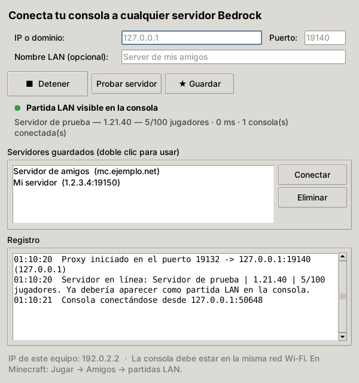

# Bedrock LAN Proxy

Conecta tu **consola** (Xbox, PlayStation, Nintendo Switch) a **cualquier servidor
externo de Minecraft Bedrock**, aunque la consola no deje añadir servidores.

La idea es la misma que la de apps como *BedrockTogether*: escribes la IP del
servidor, pulsas un botón y en la consola aparece una **partida LAN**. Al entrar
en ella, la app te lleva al servidor real.



*Captura hecha con un servidor de prueba local.*

> **Consolas con la versión 26.60 o posterior:** desde la 26.60 (octubre de
> 2026) Minecraft Bedrock busca y abre las partidas LAN con un protocolo nuevo,
> *NetherNet* (WebRTC, puerto UDP 7551), en lugar de RakNet (puerto 19132). La
> app de Android responde a esa búsqueda y recibe a la consola por WebRTC: la
> hace aparecer un momento en un mundo vacío y la manda al servidor con un
> paquete *Transfer*. Desde ahí la consola juega conectada directamente al
> servidor y la app ya no hace falta. El proceso sigue el que documentan los
> proyectos abiertos [BedrockLAN](https://github.com/DanTheMan827/BedrockLAN),
> [node-nethernet](https://github.com/PrismarineJS/node-nethernet) y
> [go-nethernet](https://github.com/df-mc/go-nethernet).

## Cómo funciona

La app de Android tiene dos modos:

- **Transferir (recomendado):** el teléfono hace de mini servidor. Cuando la
  consola entra en la partida LAN, le envía el paquete oficial *Transfer* de
  Minecraft con la IP y el puerto del servidor real. La consola se conecta
  directamente y **ya puedes cerrar la app**: solo hace falta para entrar. Si
  una consola ignora la transferencia, la app la desconecta con un aviso y en
  el siguiente intento usa el modo puente automáticamente.
- **Puente:** el teléfono reenvía todo el tráfico, así que debe seguir
  encendido mientras juegas. La versión de PC funciona siempre así.

Esquema del modo puente:

```
 Consola  ──(red local / Wi-Fi)──▶  Esta app (móvil o PC)  ──(internet)──▶  Servidor externo
   ▲  "¿hay partidas LAN?"                    │  responde: "sí, <nombre del servidor>"
   └──────────────────────────────────────────┘  y luego reenvía todo el tráfico
```

1. Cuando abres la pestaña **Amigos** en Minecraft, la consola busca partidas
   LAN en el puerto UDP **19132** de tu red local.
2. La app responde con el nombre, la versión y los jugadores del servidor real.
   Para eso le hace ping cada pocos segundos.
3. Cuando entras, cada paquete de la consola se reenvía al servidor y cada
   respuesta vuelve a la consola. Para el servidor, eres un jugador normal y tu
   cuenta de Xbox Live funciona igual.

No hace falta instalar nada en la consola ni tocar el router.

Hay dos versiones que hacen lo mismo:

- **📱 Android** (recomendada): el teléfono hace de puente. Ver [App Android](#-app-android).
- **💻 PC** (Windows, macOS, Linux): ver [Uso rápido en PC](#uso-rápido-en-pc).

## 📱 App Android

### Instalar

1. En GitHub, abre la pestaña **Actions** → el último run de *Pruebas y
   ejecutables* → sección **Artifacts** → descarga **BedrockLanProxy-Android**.
2. Es un `.zip`: ábrelo con la app *Archivos* del teléfono y saca
   `BedrockLanProxy.apk`.
3. Toca la APK para instalarla. Android pedirá permitir **instalar apps de
   origen desconocido** para tu navegador o gestor de archivos.
4. Requiere Android 8.0 o superior.

> Todas las versiones se firman con la misma clave, así que una APK nueva se
> instala encima de la anterior. La cabecera de la app muestra la versión
> (por ejemplo, v1.1.15).

### Usar

1. Conecta el teléfono y la consola a la **misma red Wi-Fi**. También vale
   conectar la consola al **punto de acceso** del teléfono.
2. Abre la app, escribe la IP o el dominio del servidor y pulsa
   **▶ Iniciar partida LAN**. Acepta el permiso de notificaciones.
3. Abre Minecraft en la consola → **Jugar** → **Amigos** y pulsa la partida
   de *Partidas LAN*.
4. En modo **Transferir**, la consola carga un momento y entra en el servidor.
   Cuando el registro diga «se ha ido al servidor», ya puedes cerrar la app.
   Las consolas con Minecraft **26.60 o posterior** siempre entran así.
5. En modo **Puente** (solo consolas anteriores a la 26.60) puedes apagar la
   pantalla: la app sigue funcionando y deja una notificación con un botón
   **Detener**.

Si el servidor no responde al ping (hay servidores que lo tienen desactivado,
o puede que esté apagado o que la IP o el puerto estén mal), la partida se
anuncia igualmente a los 4 segundos para que puedas intentar entrar. La app
anuncia la versión de Minecraft que usó tu consola la última vez, para que la
consola la muestre como compatible.

### Cuando Minecraft se actualiza

- Las actualizaciones pequeñas (correcciones como la 26.63) no cambian el
  protocolo y no afectan.
- Las grandes cambian el número de protocolo. La app ya contempla los cambios
  de formato conocidos hasta el **protocolo 2259** (1.26.70).
- Si un día deja de entrar, mira en el registro **«La consola usa el protocolo
  …»**. Si es un número mayor que 2259, la app avisa y hace falta actualizarla.
- El flujo **Compatibilidad con Minecraft** de GitHub Actions se ejecuta cada
  semana con la última versión de la librería
  [bedrock-protocol](https://github.com/PrismarineJS/bedrock-protocol):
  comprueba el formato de los paquetes y simula una consola 26.60+ entrando por
  NetherNet. Si falla, GitHub envía un correo antes de que lo notes en la
  consola.

La app también tiene servidores guardados (toca para rellenar, mantén pulsado
para borrar), **Probar servidor** y un registro de lo que pasa.

**Si la partida deja de verse con la pantalla apagada:** algunos fabricantes
(Xiaomi, Samsung, Huawei…) cierran apps en segundo plano. Ve a *Ajustes →
Aplicaciones → Bedrock LAN Proxy → Batería* y elige **Sin restricciones**.

## Uso rápido en PC

> La versión de PC solo funciona como puente con consolas **anteriores a la
> 26.60**. Para consolas actualizadas, usa la app de Android.

**Requisito:** el PC con el programa y la consola tienen que estar en **la misma red**
(el mismo router o Wi-Fi).

### Opción A: ejecutable (sin instalar Python)

Cada vez que se sube código a GitHub, el workflow *Pruebas y ejecutables* genera:

- `BedrockLanProxy.exe` para Windows,
- binarios para macOS y Linux.

Descárgalos desde la pestaña **Actions** del repositorio, en el último run,
sección *Artifacts*.

### Opción B: con Python 3.8 o superior

No necesita dependencias externas.

```bash
python run.py                       # abre la ventana
python run.py --cli                 # menú interactivo en la terminal
python run.py play.servidor.net     # conecta directamente, sin menús
python run.py 1.2.3.4:19150 -n "Server de mis amigos"
```

También se puede instalar con `pip install .` y ejecutar con `bedrock-lan-proxy`.

### En la ventana

1. Escribe la **IP o dominio** del servidor y el **puerto** (normalmente 19132).
2. Opcional: escribe el nombre que quieres ver en la lista LAN.
3. Pulsa **▶ Iniciar partida LAN**. Cuando el punto se ponga verde
   (*Partida LAN visible en la consola*), ya está.
4. En la consola, abre Minecraft → **Jugar** → pestaña **Amigos**. El servidor
   aparece en *Partidas LAN*.

Con **★ Guardar** el servidor queda en la lista de favoritos (doble clic para
conectar). Los favoritos se guardan en `~/.bedrock_lan_proxy/servidores.json`.
**Probar servidor** comprueba si el servidor responde y muestra su versión y
jugadores.

### Menú de terminal (`--cli`)

```
=== Bedrock LAN Proxy v1.0.0 ===
1) Conectar a un servidor
2) Servidores guardados
3) Guardar un servidor
4) Probar un servidor
5) Salir
```

## Problemas frecuentes

| Problema | Solución |
|---|---|
| No aparece la partida LAN | Comprueba que la consola y el teléfono o PC están en la misma red. Las redes de invitados y algunos routers con «aislamiento de clientes» o «AP isolation» bloquean el descubrimiento LAN. |
| Windows pregunta por el firewall | Pulsa **Permitir** en *redes privadas*. Si lo rechazaste, ve a *Firewall de Windows → Permitir una aplicación* y activa la app (o `python.exe`). |
| «No se pudo abrir el puerto UDP 19132» | Minecraft u otro programa está usando ese puerto en el mismo dispositivo. Cierra Minecraft en el teléfono o PC mientras usas la app. |
| El punto se queda en naranja o rojo | El servidor no responde: revisa la IP y el puerto con **Probar servidor**. |
| «Versión desactualizada» al entrar | El servidor usa otra versión de Minecraft que tu consola. Actualiza el juego o busca un servidor compatible. |
| Expulsión justo al entrar en un servidor con puerto distinto de 19132 | Algunos servidores (poco comunes) comprueban que el puerto de conexión coincida con el suyo. Prueba la dirección alternativa del servidor en el puerto 19132, si la tiene. |

## Estructura del proyecto

```
bedrock_lan_proxy/
  raknet.py    # paquetes RakNet de descubrimiento (ping/pong) y MOTD
  proxy.py     # el proxy: anuncia la partida LAN y reenvía el tráfico UDP
  gui.py       # ventana (tkinter)
  cli.py       # menú interactivo y modo directo
  config.py    # servidores guardados
tests/         # pruebas con un servidor Bedrock simulado
run.py         # lanzador (también lo usa PyInstaller)

android/
  core/        # núcleo en Kotlin puro (se prueba en el ordenador):
               #   RakNet.kt, LanProxy.kt, TransferSession.kt  -> consolas < 26.60
               #   NetherNet.kt (descubrimiento), NetherNetSession.kt (WebRTC +
               #   entrada + Transfer), NetherNetIdentity.kt (firma a=identity),
               #   BedrockPackets.kt (paquetes del juego por versión)
  app/         # app Android: pantalla, servicio en primer plano, WebRTC (libwebrtc)

tools/
  check_server.py   # ¿el servidor responde por Bedrock, RakNet o Java?
  nethernet/        # comprobaciones con bedrock-protocol (formato y entrada NetherNet)
```

Para abrir la versión Android, abre la carpeta `android/` en Android Studio.
Para compilar desde la terminal: `cd android && ./gradlew :app:assembleDebug`.

## Pruebas

```bash
python -m unittest discover -v           # versión PC
cd android && ./gradlew :core:test        # núcleo de la versión Android
```

Comprobación con bedrock-protocol (necesita Node.js 24):

```bash
cd android && ./gradlew -q :core:testClasses && export CP=$(./gradlew -q :core:printTestClasspath | tail -1)
cd ../tools/nethernet && npm install --ignore-scripts && sh stub-raknet.sh
node validate.js                          # formato de los paquetes en cada versión 26.x
java -cp "$CP" com.bedrocklanproxy.core.E2eMainKt 203.0.113.50 19133 0.0.0.0 19170 Prueba 60000 transfer &
node join.js                              # consola de prueba entrando por NetherNet
```

Las pruebas levantan un servidor Bedrock simulado en local y comprueban dos
cosas: que la consola recibe la partida LAN con el nombre y los puertos
correctos, y que el tráfico de juego se reenvía en los dos sentidos (con varias
consolas a la vez, desconexiones y caídas del servidor).

## Próximos pasos posibles

- Publicar la APK como *Release* en GitHub, para descargarla con un enlace
  fijo.
- NetherNet en la versión de PC.
- Lista de servidores destacados precargada.
- Versión para iPhone.
